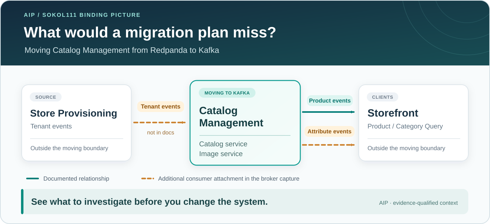
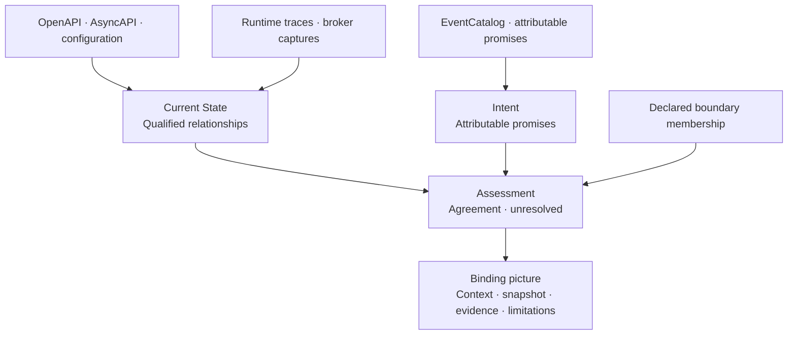

# Architecture Intelligence Platform

[](https://github.com/michaelegner/architecture-intelligence-platform/actions/workflows/ci.yml)
[](LICENSE)
[](https://mcprush.com/to/architecture-intelligence-platform-mcp?ref=badge)

**Before changing a distributed system, do you know who relies on the part you're changing?**

The answer may be spread across repositories, API contracts, broker configuration, runtime
observations, catalogs, and other teams. Some relationships are documented; others appear in
observations but have no matching documented promise.

**AIP shows who relies on what across autonomous boundaries, which promises apply, what
the evidence establishes, and what remains unresolved.** It provides evidence-qualified
architectural context that architects, engineering teams, and coding agents can inspect.

**[See the binding picture](#the-binding-picture) · [Try the hosted MCP demo](#try-aip) ·
[Technical documentation](#documentation)**

**MCP Registry:** [`io.github.michaelegner/architecture-intelligence-platform`](https://registry.modelcontextprotocol.io/v0.1/servers?search=io.github.michaelegner/architecture-intelligence-platform)

## What is AIP?

**Repository and source-analysis tools** explain implementations an engineer or agent can
inspect. **AIP complements them** with attributable architectural promises and independent
evidence about relationships across autonomous boundaries. It keeps what is promised,
observed, and unresolved distinct instead of presenting assumptions as facts.

## The binding picture

**Before moving Catalog Management to Kafka, what else must keep working?**

In [Sokol111](https://github.com/Sokol111/ecommerce-workspace), the architecture documents
show Catalog Management publishing events to Storefront. But the broker evidence reveals more:
Catalog and Image are also attached to tenant events from Store Provisioning, and Storefront
consumers are attached to attribute events. A migration planned from the documentation alone
could overlook these connections.



**AIP makes the bigger picture visible before the change starts.** Its binding picture
brings these cross-boundary relationships together, helping architects and coding agents see
which other services to investigate and where their existing understanding may be incomplete.

[Explore the hosted binding picture](examples/pitstop-demo/TRY_IT_HOSTED.md) ·
[Follow the v0.8 migration showcase](docs/release-validation/v0.8.0-release-notes.md)
## Try AIP

<a id="connect-aip-to-your-coding-agent"></a>

### Hosted MCP demo

The public, read-only endpoint serves the frozen **v0.8.0 Sokol111 C1** dataset, not live
monitoring. It requires no local AIP server or server credentials. With **Claude Code installed**,
connect to seven read-only tools, including the experimental `get_binding_picture`:

```bash
claude mcp add --transport http aip-hosted https://mcp.daip.io/mcp
```

In Claude Code, check `/mcp` and ask:

> Which bindings cross the Catalog Management boundary in environment `local` on
> broker `kafka:sokol111-local`? Show which are promised and observed, which remain
> unresolved, and resolve the relevant evidence at the same snapshot.

Use `get_binding_picture` with `bounded_context_id: catalog-management` and
`broker_ids: [kafka:sokol111-local]`. See the [hosted walkthrough](examples/pitstop-demo/TRY_IT_HOSTED.md)
for the exact request, expected findings, limitations, and troubleshooting.

### Quick Start

For an introductory, deterministic declared-versus-observed demo, install Docker with Compose,
plus `curl` and `jq`. No LLM API key is needed:

```bash
git clone https://github.com/michaelegner/architecture-intelligence-platform.git
cd architecture-intelligence-platform
cp .env.example .env
examples/runtime-demo/mcp-demo.sh
```

This separate example demonstrates `get_architecture_drift` and `get_evidence`.
Clean up with `examples/runtime-demo/mcp-demo.sh --down`.
For the full platform, see the [development guide](docs/development.md).

Other real-system examples: [Pitstop (.NET/RabbitMQ)](examples/pitstop-demo/README.md) and
[Quarkus Super Heroes](examples/quarkus-super-heroes-demo/README.md).
The [MCP client setup guide](examples/mcp-clients/README.md) covers Codex, Claude Code,
Cursor, and VS Code; previous end-to-end client qualification was performed against v0.4.2,
not re-qualified for v0.8.0.

## How AIP works

AIP combines independent sources **without treating declarations, observations, and promises
as interchangeable**. It projects only what is relevant to a selected architectural question.



AIP's deterministic architecture service uses Neo4j and makes qualified results available
through read-only REST and MCP interfaces. **Six MCP tools are enabled by default**;
`get_binding_picture` is an **experimental seventh tool** behind
`architecture_intelligence.experimental.binding-picture: true` (enabled on the hosted demo).
No LLM key is required to produce these answers.

### Declared vs observed

For direct dependency/drift answers, AIP retains these distinctions:

| Qualification | Meaning |
|---|---|
| `CONFIRMED` | Declared and observed in the relevant context. |
| `OBSERVED_ONLY` | Observed but not declared in the ingested sources. |
| `NOT_OBSERVED_IN_WINDOW` | Declared but not observed in the specified window—not proof it is absent or unused. |

These older dependency qualifications are **not** the same as the experimental v0.8
binding-picture assessment statuses.

**Boundaries matter:** A frozen broker capture establishes a group's topic attachment at capture
time, not the event types a service handles; producer declarations are not observed production;
an absent promise is not a proven violation; and the two-broker picture does not establish
cross-broker delivery. AIP keeps these limits explicit in its answers.

The public hosted endpoint is a **constrained demo** behind an HTTP edge; the AIP MCP server itself
is not a general authenticated, multi-tenant public service. Keep self-hosted MCP access local or
on a trusted network. See the [security model](docs/security-model.md).

## Documentation

**Try and integrate:** [Hosted walkthrough](examples/pitstop-demo/TRY_IT_HOSTED.md) ·
[MCP reference](docs/mcp.md) · [Client setup](examples/mcp-clients/README.md) ·
[Architecture](docs/architecture.md) · [Development](docs/development.md)

**Evidence and limitations:** [v0.8 release notes](docs/release-validation/v0.8.0-release-notes.md) ·
[Showcase evidence](docs/specifications/0.8.0/i4-evidence/README.md) ·
[v0.8 comparison](docs/specifications/evaluation/v08-showcase-value-qualification-result.md) ·
[Security](docs/security-model.md)

**Project:** [Product doctrine](docs/product-doctrine-and-strategic-direction.md) ·
[Roadmap](ROADMAP.md) · [Contributing](CONTRIBUTING.md) ·
[Discussions](https://github.com/michaelegner/architecture-intelligence-platform/discussions) ·
[Security reports](SECURITY.md)

**Current status:** [v0.8.0](https://github.com/michaelegner/architecture-intelligence-platform/releases/tag/v0.8.0)
is a shipped **demonstration release**. The binding-picture contract remains experimental.
In a controlled 12-session comparison, AIP reduced information requests in the team-scoped
setting, but did not show a robust improvement in migration-planning quality. Real customer value
and the effort of maintaining attributable promises remain to be validated.

Apache-2.0 licensed. See [LICENSE](LICENSE) and [third-party licenses](THIRD_PARTY_LICENSES.md).
