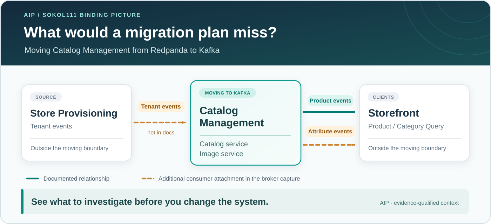

# Try the Sokol111 hosted demo

[Sokol111](https://github.com/Sokol111/ecommerce-workspace) is an open-source, multi-tenant
e-commerce system in Go. Its services exchange events through Redpanda, a Kafka-compatible broker.
The public read-only AIP instance serves a **frozen Sokol111 dataset**. It is not a view of live
traffic. The instance served Pitstop before v0.7.2 I2. You can still [run locally](../pitstop-demo/TRY_IT_LOCALLY.md)
the Pitstop demo.

The walkthrough asks one practical question:

> **If Catalog Management (the Catalog and Image services) moves from Redpanda to Kafka, which
> relationships must the team investigate before the broker changes?**

You do not run a migration. You read architecture evidence and plan.

You need:

- an MCP client that speaks streamable HTTP. Claude Code 2.1.292 or later works.
- the public MCP URL: `https://mcp.daip.io/mcp`. No credentials are required.

## Connect

```bash
claude mcp add --transport http aip-hosted https://mcp.daip.io/mcp
```

Run `/mcp`. `aip-hosted` must be connected with seven read-only tools: `get_api_consumer_usage`,
`get_architecture_drift`, `get_binding_picture` (experimental), `get_destination_consumers`,
`get_evidence`, `get_service_dependencies` and `get_service_dependencies_by_locality`. Ingestion,
imports and other AIP routes are not public.

The instance serves the v0.8 [package](../../docs/specifications/0.8.0/i1-evidence/README.md):

- one real capture of the consumer groups on the local Redpanda broker, at capture time T
  `2026-10-21T17:53:57Z`;
- authored declarations of the Services and the Topics they produce;
- a generated EventCatalog of the documented promises (catalog digest
  `ff24602762eb2bac4d56955900b82f00f23f01dc5479a12140719753e9ae250e`).

Each answer names its snapshot. On this instance it is
`aip:snapshot:v1:7f171aea2d3c5070e6be3dd9c6b53a234ad75934be5724681b95cd3e1705c413`.

## Step 1 — What the documents say

Sokol111 documents its architecture in two files, at workspace commit `f6b4c1c`:
[`platform-overview.md`](https://github.com/Sokol111/ecommerce-workspace/blob/f6b4c1ce723cb3be83eda73d74b2bacb9c584f17/docs/architecture/platform-overview.md)
and
[`product-update-flow.md`](https://github.com/Sokol111/ecommerce-workspace/blob/f6b4c1ce723cb3be83eda73d74b2bacb9c584f17/docs/architecture/product-update-flow.md).
They describe these event flows:

- Catalog publishes product and category events. The Product and Category Query services build the
  storefront's read models from the broker.
- Product Query and Image consume `ProductUpdated`. Image publishes `ProductImagePromoted`, and
  Product Query consumes it.
- The Tenant service publishes `TenantUpdated`. The documents name no service that receives it.

So the team's starting belief is: Catalog Management sends product and category events to the
Storefront. This is a useful starting point. It is not an inventory of what is attached to the
broker.

## Step 2 — What AIP shows beyond that

Ask:

> *"What does the available evidence establish about the bindings crossing Catalog Management's
> boundary, including relationships not covered by the EventCatalog?"*

The agent calls `get_binding_picture`. The illustration below is the same **high-level
binding picture** used in the repository README. It highlights the documented product
flow alongside the additional tenant-topic and attribute-topic consumer attachments.
It is not a visualization of every row or the complete EventCatalog assessment; use
the nine-row table immediately below for the exact consumer, crossing and promise status.



In this illustration, **solid teal** indicates a documented relationship and **dashed amber**
indicates additional consumer attachments in the broker capture. The diagram intentionally
simplifies the source evidence: documentation is **not** identical to a generated EventCatalog
promise. In particular, Category Query's category-topic attachment is unresolved in the
catalog despite the documented category flow. Every attachment refers to the frozen capture
at T; it does not establish event-type handling or message delivery.

The full answer is `PARTIAL`, with nine rows. Each row is one consumer Service × Topic:

| Consumer | Topic | Relative to Catalog Management | Promise and observation |
|---|---|---|---|
| Product Query | `catalog.product.events` | `OUTBOUND` | `PROMISED_AND_OBSERVED` |
| Image | `catalog.product.events` | `INSIDE` | `PROMISED_AND_OBSERVED` |
| Catalog | `tenant.tenant.events` | `INBOUND` | `UNRESOLVED` |
| Image | `tenant.tenant.events` | `INBOUND` | `UNRESOLVED` |
| Category Query | `catalog.category.events` | `OUTBOUND` | `UNRESOLVED` |
| Product Query | `catalog.attribute.events` | `OUTBOUND` | `UNRESOLVED` |
| Category Query | `catalog.attribute.events` | `OUTBOUND` | `UNRESOLVED` |
| Product Query | `tenant.tenant.events` | `NONE` | `UNRESOLVED` |
| Category Query | `tenant.tenant.events` | `NONE` | `UNRESOLVED` |

What this means:

- Two rows are promised in the EventCatalog **and** observed at T.
- Seven rows are observed, but `UNRESOLVED` (`PROMISE_COVERAGE_MISSING`): the demo EventCatalog has no
  matching promise. This does not mean that no agreement exists somewhere else.
- **Category Query × `catalog.category.events`** is a gap in catalog coverage. The documents do
  describe category events that reach the Storefront. But the arrow to the query services names no
  event, so the fixed catalog generation rule gives Category Query no `receives` promise.
- The relationships that are **really additional** are the tenant and attribute attachments. No
  document names them.

### Exact MCP request

```json
{"request": {"mode": "query", "bounded_context_id": "catalog-management", "environment": "local", "broker_ids": ["kafka:sokol111-local"]}}
```

## Step 3 — Why it matters for the migration

Now add the planned change: Catalog and Image move from Redpanda to Kafka. This step makes **no new
tool call**. Ask the agent to interpret the Step 2 answer:

> *"Which observed inbound and outbound attachments need investigation if Catalog Management changes
> brokers, and which ones are internal or outside this boundary?"*

The nine rows from Step 2 sort into three groups:

- **Inbound.** Catalog and Image are attached to `tenant.tenant.events`, which Store Provisioning
  produces. The moved services need a plan for this input.
- **Outbound.** Product Query is attached to `catalog.product.events`. Category Query is attached to
  `catalog.category.events`. Both are attached to `catalog.attribute.events`. These services stay on
  Redpanda, so their attachments need investigation before the producers move.
- **Not crossing.** Image × `catalog.product.events` is inside Catalog Management. The tenant
  attachments of Product Query and Category Query are outside this boundary. They stay visible as
  context. They are not crossings.

C1 has one broker, so it shows no cross-broker path. The migration plan must decide how each of
these Topics reaches its consumers across the two brokers. AIP does not design or verify that path.
The picture changes the questions to ask and the teams to involve.

## Step 4 — How AIP knows that Catalog is attached to the tenant topic

Ask:

> *"Why does AIP show Catalog consuming the tenant topic, and what exactly establishes that?"*

Two pieces of evidence support the Catalog × `tenant.tenant.events` row:

- **The broker capture.** At T, the consumer group `ecommerce-catalog-service` was attached to
  `tenant.tenant.events` (`KAFKA_ATTACHMENT`, with the capture's content digest).
- **The mapping.** An authored mapping artifact assigns that group to the Catalog Service
  (`KAFKA_SERVICE_MAPPING`, with the artifact's digest).

The evidence lookup resolves only these two. The row has no promise reference. The other facts come
from the binding-picture row, and they are **authored**, not observed:

- the producer, Tenant (Store Provisioning, declares `TenantUpdated`);
- the membership of Catalog and Tenant in their bounded contexts.

What this evidence does not establish:

- which event types Catalog handles;
- message delivery, offsets or lag;
- that the attachment still exists, or will exist after T;
- that no other consumer exists;
- that any replication mechanism works.

That no attachment was observed does not prove that none exists.

### Exact MCP request

The agent calls `get_binding_picture` in evidence mode, with the row's two refs. The refs must be
sorted:

```json
{"request": {"mode": "evidence", "snapshot_id": "aip:snapshot:v1:7f171aea2d3c5070e6be3dd9c6b53a234ad75934be5724681b95cd3e1705c413", "bounded_context_id": "catalog-management", "environment": "local", "broker_ids": ["kafka:sokol111-local"], "evidence_refs": ["binding-evidence:0292efcfba50e7444fb5decd6ac41d695edd1e6eb8dd90890e1f64bd02ced5e6", "binding-evidence:2e802e918dffe51fee2d5f6024d74bfe67dd63704edeecbbf48f5c9d335544ee"]}}
```

The answer is `ANSWERED`, with two `RESOLVED` entries: `KAFKA_SERVICE_MAPPING` (group
`ecommerce-catalog-service` → `service:ecommerce-catalog-service`) and `KAFKA_ATTACHMENT` (the same
group on the tenant Topic, captured at T).

## Step 5 — What to investigate before the broker changes

The checklist comes from the rows that cross the boundary:

1. Talk to the owners of **Catalog** and **Image** (inbound tenant topic), **Product Query** and
   **Category Query** (outbound product, category and attribute topics), and **Store Provisioning**,
   the tenant producer. Confirm the real owners. A business-area label does not identify every
   owner.
2. List the inbound and outbound Topics that the move needs. Plan how each one is routed across the
   two brokers, in both directions where necessary. AIP has not established a bridge or a working
   replication.
3. Validate event handling, consumer offsets and lag, replication progress and application
   behaviour with broker tools, application tools and tests. The binding picture does not establish
   them.
4. Close the missing promise coverage in the generated EventCatalog. Ask the responsible teams about
   agreements outside it.
5. Check the current state again before the cut-over. This demo uses a frozen capture.

> Sokol111's documentation shows a few event flows. AIP brings additional captured
> attachments and their evidence into one boundary-specific picture, distinguishing what
> is promised, observed and unresolved. The migration team can now see **which services
> and broker paths to investigate before changing Catalog Management**—without mistaking
> an observed attachment for proven end-to-end delivery.

**What AIP adds.** Source code, configuration and broker tools can show each of these facts
separately. AIP puts the authored promises, the captured attachments, the Service and boundary
mapping, and the limits of the evidence into one answer for one question. Each statement says which
kind of evidence supports it.

**What AIP does not establish.** Event-type handling, delivery, offsets, lag, complete promise
coverage or complete consumer coverage. This is a demonstration of a capability. It is not proof that
AIP produces better plans in real organisations.

---

## Reference and additional examples

### Limitations in every binding-picture answer

`get_binding_picture` is **experimental** (`experimental.binding-picture`).

| Limitation | Meaning |
|---|---|
| `PROMISES_ASSUMED_CONFIRMED` | The catalog entries count as confirmed promises by a demonstration assumption. The owners in the catalog are illustrative |
| `PRODUCER_SIDE_DECLARED_ONLY` | Producers come from the declarations. No producer traffic was observed |
| `EVENT_HANDLING_NOT_ESTABLISHED` | An attachment shows a consumer group's topic assignment, not which event types the Service handles |
| `CAPTURE_SCOPE_LIMITED` | The capture covers only its configured groups at its own T. It is not live monitoring |

### Also try: the consumers of one topic

`get_destination_consumers` needs the exact Topic id. No tool looks it up by name:

```text
broker_id:   kafka:sokol111-local
environment: local
Topic id of catalog.product.events: topic:owned:5534005a20357fa91c86e22e83f557c20a0be39302067e509fa59c85eb034539
```

Ask, for example: *"Which Services consume `catalog.product.events`, and how sure can we be?"* The
answer is `PARTIAL` with `CAPTURE_SCOPE_LIMITED`. Two consumer groups were attached at T, and each is
`RESOLVED` to a declared Service through explicit mapping evidence:
`ecommerce-product-query-service` and `ecommerce-image-service`. The answer does not say that these
Services consume now, that they process every message, or that no other consumer exists.

To plan a change against the source, clone the revisions in the package's
[`freeze.md`](../../docs/specifications/0.7.2/i2-evidence/sokol111/freeze.md).

### Recorded stories (not interactive)

The hosted instance serves the pre-move capture C1 only. The stories below are **recorded results**.
You cannot query them on the hosted instance.

**Wave 1: after the move.** In the v0.8 showcase, a coding agent moved Catalog Management to Kafka,
with MirrorMaker 2 between the brokers. The operator then captured both brokers. On Kafka, Catalog
and Image are attached to the tenant topic, and Image to the product topic. On Redpanda, Image ×
`catalog.product.events` is `PROMISED_NOT_OBSERVED`. Broker tools and a functional test, not AIP,
established replication progress and application behaviour. The run did not meet every acceptance
check. See the [v0.8 release notes](../../docs/release-validation/v0.8.0-release-notes.md) and the
[I4 evidence](../../docs/specifications/0.8.0/i4-evidence/README.md).

**Wave 2: who relies on Store Provisioning?** After wave 1, Product Query and Category Query are
attached to `tenant.tenant.events` on Redpanda, and Catalog and Image on Kafka. The producer is
declared on Redpanda. `cross_broker_producers: true` marks a cross-broker path to investigate. It
does not prove delivery or a bridge. The recorded
[`answers-after.json`](../../docs/specifications/0.8.0/i4-evidence/answers-after.json) is scoped to
Catalog Management, not to Store Provisioning. So on the tenant topic, the Product Query and
Category Query rows have `crossing: NONE`, and `cross_broker_producers: true` is only on the
Kafka-side Catalog and Image rows. No answer scoped to Store Provisioning was recorded. The outcome
for a Store Provisioning move: its owners plan for tenant consumers on both brokers, Product Query
and Category Query on Redpanda, and Catalog and Image on Kafka. They confirm each path with those
teams and with broker tools.

### Separate Pitstop demo

For the .NET/RabbitMQ example, see the [Pitstop local walkthrough](../pitstop-demo/TRY_IT_LOCALLY.md).

### Troubleshooting

| Symptom | Likely cause |
|---|---|
| `/mcp` cannot connect | check the URL is `https://mcp.daip.io/mcp` exactly |
| `421 Invalid Host header` | use `https://mcp.daip.io/mcp` exactly |
| `429 Too Many Requests` | the public rate limit was reached; wait briefly and retry |
| `UNKNOWN_DESTINATION` | use the Topic id above, not the topic name |
| `get_binding_picture` is missing | reconnect; the hosted instance lists it since v0.8.0 |
| another snapshot id, or not nine rows | the instance serves different data from this page; compare the snapshot id with the one under [Connect](#connect) |
| `evidence_refs must be sorted and unique` | sort the refs; take them from an answer on the same snapshot |
